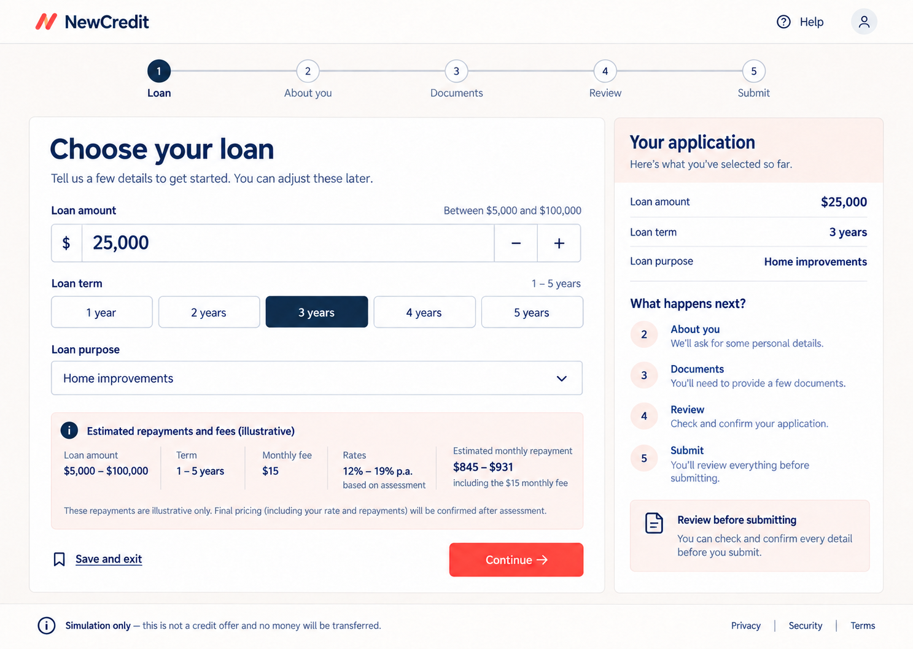

# NewCredit UI Design System

**Status:** Approved v1.0

**Direction:** Digital utility with calm warmth

## 1. Design intent

NewCredit should feel as clear and dependable as a leading Australian neobank
without copying an existing bank's identity. The selected direction combines:

- the structured application layout, dark navy hierarchy, and restrained action
  colour from the Digital Utility concept; and
- the warm backgrounds, approachable surfaces, and generous spacing from the
  Calm Confidence concept.

The experience is an application tool, not a marketing site. Each screen has one
primary task, visible progress, plain-language help, and the information needed
to make the next decision. Avoid promotional banners, lifestyle photography,
gamification, urgency, confetti, or celebratory language about borrowing.

## 2. Approved visual reference

The image establishes composition and visual tone; it is not a pixel-perfect
specification. Implemented content, accessibility, states, and calculations must
follow the requirements and this document. The design tokens below take priority
over colours sampled from the image.

The reference values are valid for the illustrated selection:

- amount: AUD 25,000;
- term: 3 years;
- product rates: 12%–19% p.a., based on assessment;
- monthly fee: AUD 15; and
- estimated monthly scheduled repayment: AUD 845–931 including the monthly fee.

The displayed repayment range is illustrative. Final pricing and repayment are
confirmed only after assessment.

## 3. Experience principles

1. **One clear task:** one primary heading and one primary action per screen.
2. **Progress without pressure:** show where the applicant is and what follows,
   without countdowns, urgency, or artificial scarcity.
3. **Terms near decisions:** show ranges, fees, assumptions, and simulation
   wording beside the relevant choice.
4. **Explain before asking:** describe why a document or financial detail is
   required before collection.
5. **Show provenance and uncertainty:** distinguish declared, extracted,
   corrected, and transaction-derived values; never hide low confidence.
6. **Make recovery obvious:** preserve valid input, explain errors in plain
   language, and provide a safe retry when an operation fails.
7. **Never imply certainty:** document checks are signals, the outcome is
   indicative, and simulated disbursement never moves money.

## 4. Colour tokens

| Token | Value | Use |
| --- | --- | --- |
| `ink-950` | `#102A43` | Headings, selected controls, high-emphasis text |
| `ink-700` | `#334E68` | Body text |
| `ink-600` | `#52657A` | Secondary text; passes AA on white |
| `action-700` | `#C93832` | Primary button and actionable emphasis |
| `action-800` | `#A92F2B` | Hover and pressed action state |
| `action-100` | `#FCE8E5` | Warm selected or information surface |
| `canvas` | `#FBFAF8` | Page background |
| `surface` | `#FFFFFF` | Form and summary surfaces |
| `surface-warm` | `#FFF3EF` | Illustrative pricing and guidance panels |
| `border` | `#CBD5E1` | Control and card borders |
| `focus` | `#2563EB` | Keyboard focus ring |
| `success` | `#18794E` | Completed or confirmed state |
| `warning` | `#9A5B13` | Needs-attention state |
| `danger` | `#B42318` | Error state |

White text on `action-700` has a contrast ratio above 5:1. The brighter vermilion
shown in the concept may be used only for a non-text brand mark or decoration;
it must not replace `action-700` behind normal-size white text.

Do not rely on colour alone. Selected, complete, warning, and error states also
need text, iconography, border treatment, or a checked state.

## 5. Typography and iconography

- Use Inter Variable, self-hosted with `@fontsource-variable/inter`, with a
  system sans-serif fallback.
- Use sentence case. Avoid condensed display fonts and all-caps campaign text.
- Use 700 weight for page headings, 600 for section headings and controls, and
  400–500 for body content.
- Keep body text at 16px minimum and supporting text at 14px minimum.
- Use a fluid page heading from 32px on small screens to 48px on wide screens.
- Keep line length near 65 characters for explanatory copy.
- Use Lucide icons at consistent 20px or 24px sizes. Icons supplement labels and
  never replace them for consequential actions.
- The NewCredit brand mark must be original and remain distinct from Westpac or
  any other financial institution's logo.

## 6. Layout and spacing

- Use an 8px spacing grid, with 4px only for tightly related text or icons.
- Limit the application content to 1,344px with 24–48px page gutters.
- On wide screens, use a two-column application layout: the task panel takes
  roughly two thirds and the summary takes one third.
- Keep the summary visible while scrolling only when it fits without obscuring
  content; sticky positioning is a desktop enhancement, not a requirement.
- Prefer 12px control radii and 16px panel radii. Pills are reserved for status,
  not every control.
- Use borders and spacing before shadows. If a shadow is needed, keep it subtle
  and never use it as the only boundary.
- Keep the primary action at the lower end of the task flow and visually separate
  it from `Save and exit`.

## 7. Application stages

The primary progress model has five stages:

1. **Loan:** amount, purpose, and whole-year term.
2. **About you:** customer, household, employment, income, expenses, assets, and
   liabilities. Existing-customer details may be pre-populated.
3. **Documents:** licence when required, payslips, bank statements, account
   coverage, upload status, and processing.
4. **Review:** extracted values, sources, confidence, corrections, transaction
   summary, and declarations.
5. **Submit:** final verification and explicit submission.

Outcome, offer, acceptance, and simulated funding are post-submission states,
not additional incomplete steps in the application progress indicator.

On desktop, display all five labelled stages. On narrow screens, show the current
stage name, `Step N of 5`, and a compact progress bar; do not squeeze all labels
into a horizontal row.

## 8. Core components

### Application header

Show the original NewCredit wordmark, Help, and customer/session control when
applicable. Do not reproduce a retail-bank product navigation bar inside the
application.

### Task panel

Use one `h1`, a short explanation, logically grouped fields, inline guidance,
and one primary action. Required and optional status must be explicit.

### Application summary

Summarize confirmed selections and explain what follows. Avoid duplicating every
editable field. On tablet and mobile it moves below the active task or becomes a
collapsible `Application summary` region.

### Money input

Display AUD clearly and use integer cents internally. If increment controls are
present, they need accessible names, 44px minimum targets, documented increments,
and disabled states at limits. A slider can supplement but never replace direct
entry.

### Choice group

Implement term choices as a labelled radio group. Selection uses a checked state,
dark fill or strong border, and text—not colour alone. Mobile labels may use
`1 yr` through `5 yrs` when the group legend states `Loan term in years`.

### Information panel

Use warm surfaces for contextual pricing, fee, or process information. An
information panel is not an error or promotional banner.

### Status and feedback

Use dedicated patterns for processing, success, needs review, error, and
unavailable states. Announce asynchronous updates with an appropriate live
region without repeatedly interrupting screen-reader users.

### Simulation notice

Show `Simulation only` consistently across application, outcome, offer, and
funding screens. On any offer or funding screen use the complete wording:
`Simulation only—no money was transferred.` Persistence means the notice appears
in every relevant state; it does not need to consume fixed viewport space.

## 9. Responsive behaviour

### Wide: 1,024px and above

- Full horizontal progress indicator.
- Form and summary in two columns.
- Five term options on one row.
- Pricing details may use a horizontal fact layout.

### Medium: 768–1,023px

- Single task column with summary below or in a disclosure panel.
- Horizontal stage labels may collapse to current-stage text and a progress bar.
- Pricing facts wrap into a two-column grid.

### Narrow: below 768px

- One column and 16–20px page gutters.
- Current stage plus `Step N of 5`; no horizontally scrolling stepper.
- Full-width primary action and clearly separated secondary action.
- Term choices remain a real radio group in a five-column compact row when they
  fit at 44px minimum; otherwise use a two-row grid.
- Pricing facts stack vertically.
- Summary becomes a disclosure below the page introduction.
- Footer links wrap, and the simulation notice remains readable without covering
  controls.

The future SwiftUI application should reproduce these information and state
priorities, not attempt to share React components or exact web measurements.

## 10. Accessibility baseline

- Meet WCAG 2.2 AA.
- Maintain at least 4.5:1 contrast for normal text and 3:1 for large text and
  meaningful control boundaries.
- Provide visible `:focus-visible` rings with at least a 2px focus indicator and
  separation from the component edge.
- Keep interactive targets at least 44×44 CSS pixels.
- Use native controls where possible and preserve expected keyboard interaction.
- Associate errors and hints programmatically with their fields.
- Move focus to the page heading after stage navigation and to the first invalid
  field after failed submission.
- Do not automatically advance when a selection is made.
- Support browser zoom to 200% and reflow at 320 CSS pixels without loss of
  content or horizontal page scrolling.
- Respect reduced-motion preferences. No required information depends on
  animation.

## 11. Content rules

- Use Australian English and AUD.
- Prefer direct labels such as `Loan amount`, `Monthly fee`, and `Continue`.
- Call estimates `illustrative` and state what may change.
- Never claim guaranteed approval, guaranteed timing, bank-level security, no
  hidden fees, or support availability unless separately approved and evidenced.
- Never label an automated document signal as proof of fraud.
- Never call the nominal annual rate a comparison rate.
- Show rates, the monthly fee, repayment assumptions, and total repayable where
  required by the relevant screen.
- Do not use generic success celebrations for approval or funds simulation.

## 12. Required design states

Before a flow is implementation-complete, design and verify:

- default, hover, focus, selected, disabled, and validation-error controls;
- empty, uploading, processing, complete, failed, and needs-review documents;
- extracted, low-confidence, conflicting, and applicant-corrected values;
- transaction loading, categorized, unknown, and empty results;
- affordable, marginal, unaffordable, and undetermined affordability;
- approved, referred, not-approved, and withheld outcomes; and
- offer ready, accepted, disbursement processing, failed/retry, completed, and
  cancelled simulation states.

Use the approved visual reference as the starting point, then verify each state
at wide, medium, and narrow widths before implementation is considered complete.
